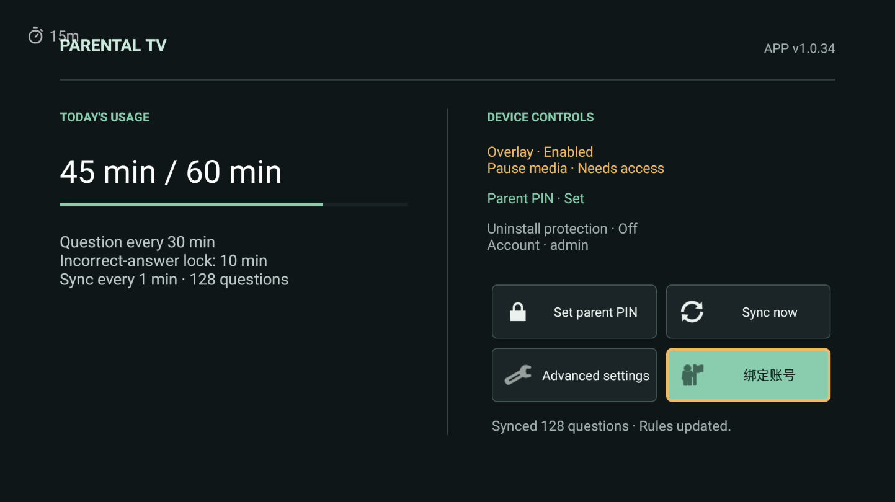
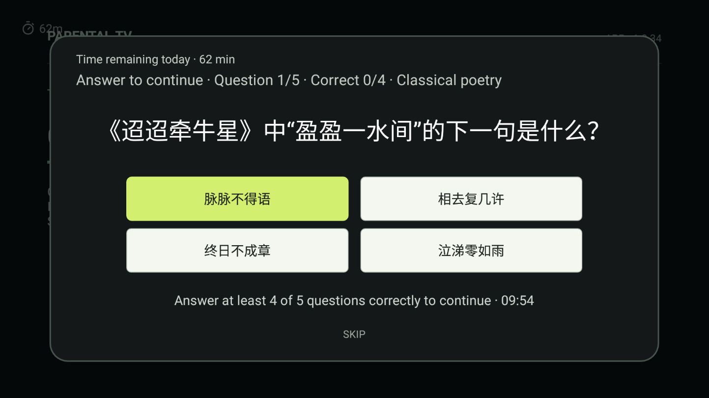
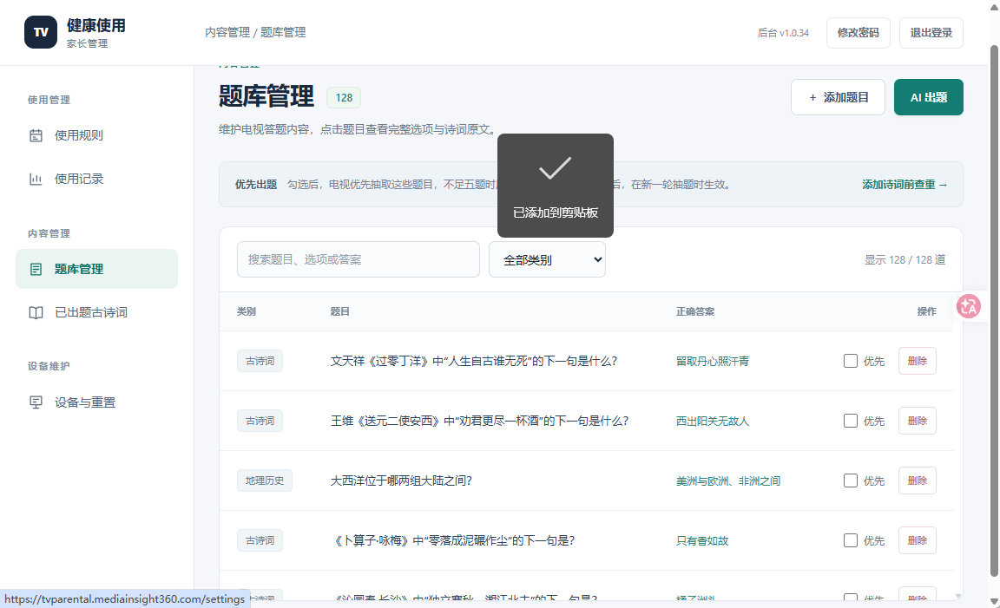
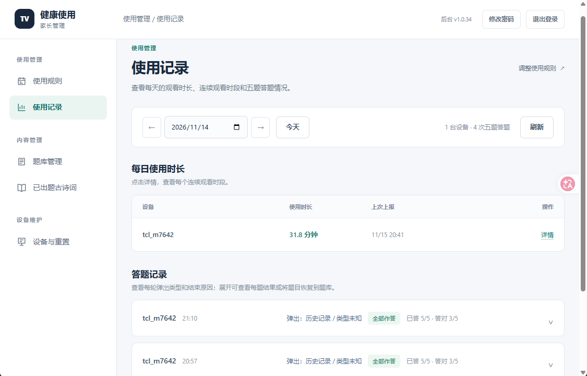

# TV Parental Control

## 编译

1. 安装 Android Studio，使用自带 JBR 或 JDK 17+。
2. 在 SDK Manager 安装 Android SDK Platform 37 和 Platform-Tools。
3. 用 Android Studio 打开仓库根目录，完成 Gradle 同步并生成本机 `local.properties`，不要复制其他电脑的 SDK 路径。

无需安装全局 Gradle，项目使用 Gradle Wrapper 9.1.0；首次构建可能需要下载：

```powershell
.\scripts\build.bat
```

版本号在 `VERSION`，APK 输出到 `app\build\outputs\parental\Parental-TV-v<版本号>.apk`。详细环境配置与排障见 [Android 编译与安装](docs/README_BUILD.md)。

## 安装

### 模拟器

先在 Android Studio Device Manager 创建 Android TV API 28 虚拟设备，再用脚本启动：

```powershell
powershell -NoProfile -ExecutionPolicy Bypass -File .\scripts\start_emulator.ps1
```

脚本自动查找 SDK；只有一个 AVD 时直接启动，多个时提示选择。也可列出设备或指定名称：

```powershell
powershell -NoProfile -ExecutionPolicy Bypass -File .\scripts\start_emulator.ps1 -List
powershell -NoProfile -ExecutionPolicy Bypass -File .\scripts\start_emulator.ps1 -AvdName "AVD_NAME"
```

将 `AVD_NAME` 替换为列表中的名称，等待模拟器启动完成后安装：

```powershell
.\scripts\install_emulator.bat
```

脚本使用覆盖安装，保留模拟器中的本地设置、PIN 和绑定凭证。API 28 TV 模拟器没有悬浮窗设置页，可通过 ADB 放行；将 `emulator-5554` 替换为 `adb devices` 中的实际序列号：

```powershell
adb devices
adb -s emulator-5554 shell appops set com.example.tvparental SYSTEM_ALERT_WINDOW allow
```

### 真机

各型号和固件的菜单可能不同：

| 电视 | 怎么打开 |
| --- | --- |
| 小米 / Redmi | 设置 → 关于 → 连续按「产品型号/产品类型」进入开发者模式，再到 设置 → 账号与安全，打开「ADB 调试」和「安装未知来源的应用」。 |
| TCL / 雷鸟 | 设置 → 关于 → 本机信息，快速按遥控器「上下左右」，在底部的「更多」里打开 ADB。 |
| 海尔 / 模卡 | 按电视机身上的信号源键，再用遥控器按「左左上右」，在工厂菜单里打开「ADB 调试开关」，别动其他选项。 |
| 海信 / Vidda | 设置 → 声音，关闭杜比全景声；在 专业音响设置 → 声音平衡 里快速交替按「确认」「菜单」，左上角出现 M 后按「菜单」进工厂菜单，把「选项」里的 To Fac 从 U 改成 M 后重启，别动其他选项；再到 设置 → 全部设置，连按「菜单」打开原生设置，连按版本号后在开发者选项里打开「USB 调试」和「无线调试」。工厂菜单按错有风险，反复改 To Fac 可能让 USB 失灵、要重置电视，只改一次（[详细说明](https://github.com/pengchujin/aerial-tv/blob/main/docs/devices/adb-by-brand.md)）。 |
| OPPO（含 S1） | 设置 → 系统 → 关于本机 → 设备型号，按「上上右右」再按确认；再到 设置 → 系统 → 开发者选项，打开「USB 调试」。IP 在 设置 → 网络 → 已连接的网络 最下面。 |
| 其他 Android TV | 设置 → 设备偏好设置 → 关于，连续点击「版本号 / Android TV OS 版本」进入开发者模式，再返回开发者选项打开 USB 调试；如提供网络 / 无线调试，按该选项提示连接。 |

### 雷鸟 / TCL 电视安装

电脑与电视连接同一网络，电视开启 ADB 调试，确认连接后安装：

```powershell
adb connect 10.0.0.8:5555
adb devices
.\scripts\install_device.bat
```

需要 Python 3。此固件拒绝普通 `adb install`，安装脚本通过 TCL“多屏互动”推送，需在电视上确认安装。默认 IP 为 `10.0.0.8`，也可传入其他 IP（不带端口）：

```powershell
.\scripts\install_device.bat 10.0.0.9
```

IP 取值顺序：命令行参数 → 环境变量 `TV_PARENTAL_TV_IP` → 默认值 `10.0.0.8`。

安装脚本会自动放行并核验悬浮窗、自启动和关联启动权限；手动补设时运行：

```powershell
adb -s 10.0.0.8:5555 shell appops set com.example.tvparental SYSTEM_ALERT_WINDOW allow
adb -s 10.0.0.8:5555 shell appops set com.example.tvparental APP_AUTO_START allow
adb -s 10.0.0.8:5555 shell appops set com.example.tvparental APP_ASSOC_START allow
```

暂停播放器还需通知使用权，在该 TCL 电视通过 ADB 授权：

```powershell
adb -s 10.0.0.8:5555 shell cmd notification allow_listener com.example.tvparental/com.example.tvparental.MediaControlListenerService 0
```

手动执行命令需将 Android SDK 的 `platform-tools` 加入 PATH，或使用 `adb.exe` 的完整路径；目标 IP 变化时同步替换命令中的地址。完整升级、授权核验和连接清理见 [TCL 安装指南](docs/INSTALL_TCL.md)。

## 本机后台

需要 Python 3.11+，仅使用标准库，无需安装第三方依赖或单独编译：

```powershell
$env:HOST = "127.0.0.1"
$env:PORT = "8765"
python backend/server.py
```

打开 <http://127.0.0.1:8765/>。新数据库默认账号为 `admin/admin`，首次登录后可在右上角修改密码。端口冲突时修改 `PORT`；停止服务按 `Ctrl+C`。

忘记管理员密码时运行：

```powershell
python backend/server.py --set-admin
```

Android 当前固定连接 <https://tvparental.mediainsight360.com>，启动本机后台不会自动切换电视的服务地址。首次需在电视打开“绑定账号”，绑定码自动获取，在后台“设备与重置”输入绑定码；详见 [注册与绑定说明](docs/USER_GUIDE.md#注册与绑定电视)。ECS 安装、HTTPS 配置和自动发布见 [后台部署指南](docs/DEPLOY_ECS.md)。

后台测试：

```powershell
python -m unittest discover -s backend/tests -v
```

## 界面截图






## 其他文档

- [使用说明与答题规则](docs/USER_GUIDE.md)
- [用时统计说明](docs/USAGE_ACCOUNTING.md)
- [后台恢复与验证](docs/BACKGROUND_RECOVERY.md)
- [遥控器快捷按键设置](docs/REMOTE_BUTTON_CONTROL.md)
